# Ko'p Tarmoqli (Multi-Clinic) Agent & Admin DICOM Tizimi Qo'llanmasi

Ushbu qo'llanma turli klinika va filiallarga o'rnatilgan diagnostika apparatlarini (Siemens, GE, Philips, Canon MRT/MSKT) yagona markaziy serverga va bitta umumiy **FUJIFILM DRYPIX Lite** printeriga xavfsiz ulash bo'yicha to'liq arxitektura va qo'llanmadir.

---

## 1. Umumiy Arxitektura sxemasi

```mermaid
flowchart TD
    subgraph K1["🏥 Klinika / Filial 1 (Masalan: Samarqand Onko)"]
        S1["Siemens Magnetom Altea"] -->|DICOM Print Port 1005| AG1["DICOM_Spooler_Agent.exe"]
        AG1 -->|Oflayn bo'lsa| OUT1[("Mahalliy Outbox")]
    end

    subgraph K2["🏥 Klinika / Filial 2 (Masalan: Buxoro Onko)"]
        S2["GE BrightSpeed CT"] -->|DICOM Print Port 1005| AG2["DICOM_Spooler_Agent.exe"]
        AG2 -->|Oflayn bo'lsa| OUT2[("Mahalliy Outbox")]
    end

    subgraph CLOUD["☁️ GitHub Cloud Hub & Relay (github.io)"]
        GH_PAGE["🌐 GitHub Pages (Monitoring & Status)"]
        GH_STAT["admin_status.json (Heartbeat)"]
        GH_QUEUE["🔒 queue/*.enc (AES-256-GCM shifrlangan navbat)"]
        GH_TTL["⏱️ 1 soatlik avto-tozalash (TTL: 60 min)"]
    end

    subgraph MAIN["🏢 Markaziy Bosh Bino (Server Kompyuter - 10.34.14.33)"]
        ADM["🚀 DICOM_Spooler_Admin.exe"]
        WEB["🌐 Veb-panel (Port 3000)"]
        DB[("print_spooler.db (Baza & Arxiv)")]
        KARMED["🏥 KarMed MIS (192.168.150.111:2025)"]
        PRINTER["🖨️ FUJIFILM DRYPIX Lite (10.34.14.12:104)"]
    end

    AG1 -.->|1. Heartbeat tekshirish| GH_STAT
    AG1 ==>|2. Faqat Admin onlayn bo'lsa AES-256 bilan yuklaydi| GH_QUEUE
    AG2 -.->|1. Heartbeat tekshirish| GH_STAT
    AG2 ==>|2. Faqat Admin onlayn bo'lsa AES-256 bilan yuklaydi| GH_QUEUE

    ADM -->|Har 30s da Heartbeat yangilaydi| GH_STAT
    ADM ==>|Har 5s da tortib oladi va darhol o'chiradi| GH_QUEUE
    ADM --> DB
    ADM --> KARMED
    ADM --> PRINTER
    ADM --> WEB
```



---

## 2. Dastur Fayllari va Vazifalari

Tizim **2 ta alohida portativ `.exe`** fayldan iborat:

| Fayl nomi | O'rnatilish joyi | Asosiy vazifasi |
| :--- | :--- | :--- |
| **`DICOM_Spooler_Admin.exe`** | Asosiy kompyuterda (Fuji printer ulangan serverda) | Markaziy qabul qiluvchi, KarMed integratsiyasi, Veb-boshqaruv (Port 3000), Fuji printeriga chop etish, GitHub Heartbeat, Shifrlangan navbatni qabul qilib o'chirish. |
| **`DICOM_Spooler_Agent.exe`** | Turli filiallar va apparat kompyuterlarida | Mahalliy 1005-portda Siemens/GE apparatlaridan qabul qilish, oflayn navbat (Outbox), Admin holatini tekshirish, AES-256-GCM shifrlab yuborish. |

---

## 3. Xavfsizlik va Shifrlash (End-to-End Encryption)

> [!IMPORTANT]
> **Hech qanday bemor ma'lumoti ochiq holda internetga yoki GitHubga chiqmaydi!**
> - **Algoritm:** Harbiy darajadagi **AES-256-GCM** (Galois/Counter Mode).
> - **Kalit:** Faqat Agent va Admin fayllaridagi maxfiy `encryption_key` orqali hosil qilinadi.
> - **GitHubda ko'rinishi:** GitHubda faqat tushunarsiz tasodifiy matn (`.enc`) ko'rinadi. Bemorning ismi, ID raqami, kasallik tarixi va tibbiy tasviri 100% shifrlangan bo'ladi.
> - **1 soatlik muddat (TTL):** Agar plonka 1 soat ichida Adminga yetib bormasa, GitHubdan avtomatik tozalanadi.
> - **Zudlik bilan o'chirish:** Admin plonkani yuklab olishi bilan fayl sekundlar ichida GitHubdan o'chirib yuboriladi.

---

## 4. Oflayn Himoya (Store-and-Forward Qoidasi)

Foydalanuvchi talabiga asosan:
1. Agent doimiy ravishda Adminning faolligini (`admin_status.json`) tekshiradi.
2. **Agar Admin kompyuter o'chirilgan bo'lsa yoki aloqa uzilsa:**
   - Agent ma'lumotlarni **GitHubga aslo chiqarmaydi**!
   - Barcha plonkalar Agentning o'zida (`./agent_storage/outbox/`) xavfsiz saqlanib turadi.
3. **Admin qayta yoqilishi bilan:**
   - Agent Admin onlayn bo'lganini biladi va to'planib qolgan barcha plonkalarni shifrlab Adminga yetkazadi.
   - Yetkazilgan fayllar `./agent_storage/sent/` papkasiga o'tkaziladi.

---

## 5. Sozlash Qo'llanmasi

### A. Admin Sozlamasi (`config.json`)
```json
{
  "server": {
    "listen_ip": "0.0.0.0",
    "listen_port": 1005,
    "web_port": 3000
  },
  "security": {
    "encryption_key": "RESPUBLIKA_ONKO_MASTER_KEY_2026"
  },
  "github_relay": {
    "enabled": true,
    "repo": "tashkilot/dicom-hub",
    "token": "ghp_sizning_tokeningiz",
    "branch": "main",
    "queue_dir": "queue",
    "status_file": "admin_status.json",
    "ttl_minutes": 60
  },
  "printer": {
    "ip": "10.34.14.12",
    "port": 104,
    "called_ae": "DRYPIX2"
  }
}
```

### B. Agent Sozlamasi (`agent_config.json`)
```json
{
  "agent": {
    "clinic_name": "SAMARQAND VILOYAT ONKOLOGIYA DISPANSERI",
    "modality_name": "SIEMENS MAGNETOM ALTEA (MRT 2)",
    "listen_port": 1005,
    "ae_title": "DRYPIX2"
  },
  "security": {
    "encryption_key": "RESPUBLIKA_ONKO_MASTER_KEY_2026"
  },
  "admin_connection": {
    "direct_url": "http://10.34.14.33:3000/api/relay/push",
    "prefer_direct": true
  },
  "github_relay": {
    "enabled": true,
    "repo": "tashkilot/dicom-hub",
    "token": "ghp_sizning_tokeningiz",
    "status_file": "admin_status.json"
  }
}
```

---

## 6. GitHub Pages (`github.io`) Monitoring Portali

`github_pages/index.html` faylini GitHub Pages hostingiga qo'yish mumkin:
- **Nimalar ko'rinadi:** Markaziy Admin serveri holati (ONLINE / OFFLINE), Fuji printeri holati, bugungi jami qabul qilingan va chop etilgan plonkalar soni, ulangan klinikalar ro'yxati.
- **Nimalar KO'RINMAYDI:** Hech qanday bemor ismi, rasmi yoki shaxsiy ma'lumotlari chiqarilmaydi.
- Sahifa har 15 soniyada yangilanib turadi.
