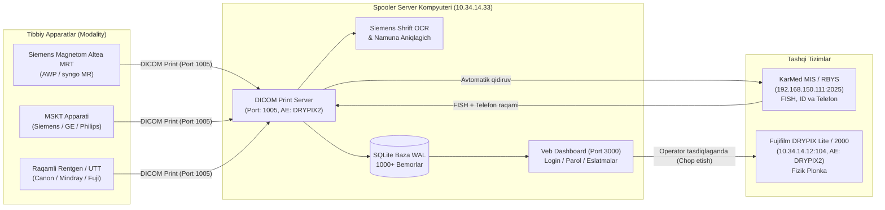

# Siemens va Boshqa Tibbiy Apparatlarni DICOM Print Spooler Serveriga Ulash Bo'yicha To'liq Qo'llanma

Ushbu qo'llanma **Siemens Magnetom Altea (MRT)**, shuningdek boshqa modallikdagi tibbiy uskunalar (**MSKT, Rentgen, UTT, Mammografiya, Angiografiya**) kompyuterlaridan chop etish (DICOM Print) so'rovlarini markaziy **DICOM Spooler Server**ga yo'naltirish va uni sozlash tartibini tushuntiradi.

---

## 1. Tizim Arxitekturasi va Ishlash Sxemasi



---

## 2. Server Ulanish Parametrlari (Spooler Configuration)

Barcha tibbiy apparatlarning sozlamalar bo'limida yangi printer (DICOM Camera / Network Printer) qo'shilganda quyidagi aniq parametrlarni kiritish shart:

| Parametr Nomi | Qiymati | Izoh |
| :--- | :--- | :--- |
| **Server IP Manzili (Destination IP / Host)** | `10.34.14.33` | Spooler dasturi ishlayotgan server kompyuter IP-si |
| **DICOM Port (TCP Port)** | `1005` | Apparatlar ushbu port orqali ma'lumot uzatadi |
| **Target AE Title (Called AE Title)** | `DRYPIX2` | Katta harflarda yozilishi tavsiya etiladi |
| **Local AE Title (Calling AE Title)** | *Apparat nomi* | Masalan: `AWP190948`, `MRT1`, `CT1`, `XR1` |
| **Qurilma Turi (Device / Protocol Type)** | `DICOM Print` | `DICOM Basic Grayscale Print Management` |
| **Plonka O'lchami (Film Size)** | `14INX17IN` | 35x43 sm (shuningdek 8x10, 10x12, 11x14) |
| **Rang Turi (Photometric)** | `MONOCHROME2` | Standart kulrang rentgen/MRT tasvirlari |

> [!IMPORTANT]
> Server barcha AE Title-lardan so'rovlarni qabul qiladi. Biroq apparatda `Target AE Title` sifatida **`DRYPIX2`** kiritilishi tavsiya etiladi.

---

## 3. Siemens Magnetom Altea (syngo MR / AWP) Sozlash Qo'llanmasi

Siemens Magnetom Altea apparatining asosiy boshqaruv stansiyasida (*Acquisition Workplace - AWP* yoki *syngo.via*) sozlash ketma-ketligi:

### 1-qadam: Sozlamalar Menyusiga Kirish
1. Monitorning yuqori menyusidan **`Options`** (yoki **`Configuration`**) bo'limiga kiring.
2. **`Service`** -> **`Local Service`** yoki **`Network Configuration`** bandini tanlang.
3. Administrator / Muhandis parolini kiriting (standart servis rejimi).

### 2-qadam: Yangi DICOM Printerni Ro'yxatdan O'tkazish
1. Chap paneldan **`Printers`** (yoki **`Hardcopy Devices`**) bo'limiga o'ting.
2. **`Add New Printer`** (yoki **`Insert Node`**) tugmasini bosing.
3. Quyidagi maydonlarni to'ldiring:
   - **Device Name (Mantiqiy nom):** `SPOOLER_1005` (yoki `SERVER_DRYPIX`)
   - **IP Address:** `10.34.14.33`
   - **Port Number:** `1005`
   - **Called AE Title:** `DRYPIX2`
   - **Calling AE Title:** Standart stansiya nomi (masalan: `AWP190948` yoki `MRT1`)
   - **Model / Type:** `DICOM Basic Grayscale Print Management Meta SOP`
   - **Default Film Size:** `14INX17IN` (14x17 dyuym)
   - **Magnification Type:** `CUBIC` yoki `BILINEAR`
   - **Smoothing Type:** `MEDIUM`

### 3-qadam: Aloqani Tekshirish (Echo / Verify)
1. Kiritilgan printer ustiga sichqonchaning o'ng tugmasini bosing yoki pastdagi **`Echo`** (**`Verify`**) tugmasini bosing.
2. Ekranda **`Verification Successful (0x0000)`** yoki yashil belgi chiqishi kerak.
3. Bu server kompyuter (10.34.14.33:1005) so'rovni muvaffaqiyatli qabul qilganini bildiradi.

### 4-qadam: Saqlash va Standart Printer Qilish
1. **`Apply`** va **`Save Configuration`** tugmalarini bosing.
2. Operator ko'rish panelida (*Viewing / Camera Sheet*) yangi yaratilgan **`SPOOLER_1005`** printerni asosiy printer sifatida tanlab qo'ying.

---

## 4. Boshqa Ishlab Chiqaruvchilar Apparatlarini Ulash (GE, Philips, Canon, Mindray)

### General Electric (GE Healthcare - Signa MRT, Revolution CT, Logic UTT)
1. Asosiy servis ekranida **`Service Desktop`** -> **`Configuration`** -> **`Network Tools`** menyusiga kiring.
2. **`DICOM Hardcopy Camera Configuration`** bo'limiga o'ting.
3. **`Add Camera`** tugmasini bosing:
   - **Logical Camera Name:** `SPOOLER_DRYPIX`
   - **IP Address:** `10.34.14.33`
   - **Port:** `1005`
   - **Remote AE Title:** `DRYPIX2`
4. **`Test Ping / Echo`** tugmasi orqali tekshirib, sozlamalarni saqlang.

### Philips (Ingenia MRT, Brilliance CT, Affiniti/EPIQ UTT)
1. **`System Preferences`** -> **`Connectivity`** -> **`DICOM Nodes`** bo'limiga kiring.
2. **`Print Servers`** yorlig'iga o'ting va **`Add Device`** tugmasini bosing.
3. Ma'lumotlarni kiriting:
   - **Device Name:** `SPOOLER_SERVER`
   - **Remote Host:** `10.34.14.33`
   - **Port:** `1005`
   - **Remote AE Title:** `DRYPIX2`
4. **`Check Connection`** tugmasini bosib aloqani tasdiqlang.

### Canon / Toshiba (Aquilion CT, Vantage MRT, Aplio UTT)
1. **`System Setup`** -> **`Peripheral Setup`** -> **`DICOM Camera / Printer`** bo'limiga kiring.
2. Yangi kamera qo'shing:
   - **Host Name / IP:** `10.34.14.33`
   - **Port:** `1005`
   - **Target AE:** `DRYPIX2`
3. Saqlang va sinov plonkasini yuboring.

---

## 5. Server Kompyuterida Windows Xavfsizlik Devorini (Firewall) Sozlash

Agar apparatdan **Echo** yoki **Print** yuborilganda `Connection Refused` yoki `Timeout` xatosi bersa, server kompyuteridagi Windows Firewall 1005 va 3000-portlarni bloklayotgan bo'lishi mumkin.

Buni ochish uchun server kompyuterida **PowerShell (Administrator sifatida)** dasturini ochib, quyidagi buyruqni bir marta bajaring:

```powershell
# DICOM Print porti (1005) uchun kiruvchi qoida
New-NetFirewallRule -DisplayName "DICOM Print Spooler (Port 1005)" -Direction Inbound -LocalPort 1005 -Protocol TCP -Action Allow

# Veb boshqaruv paneli porti (3000) uchun kiruvchi qoida
New-NetFirewallRule -DisplayName "DICOM Web Dashboard (Port 3000)" -Direction Inbound -LocalPort 3000 -Protocol TCP -Action Allow
```

---

## 6. Ishlashni Tekshirish Ketma-ketligi (Test Checklist)

Apparat ulanganidan so'ng tizimning to'liq ishlashini tekshirish uchun:

1. **DICOM Echo (Tekshirish):**
   - Apparatdan `10.34.14.33:1005` ga `Echo / Verify` yuboring.
   - Natija: `Success (0x0000)` bo'lishi kerak.
2. **Sinov Chop Etish (Test Print):**
   - Apparatda bitta bemorning bir necha kadrini virtual plonkaga joylashtiring.
   - Manzil sifatida `SPOOLER_1005` ni tanlab, **`Print`** (Chop etish) tugmasini bosing.
3. **Serverda Qabul Qilinishi:**
   - Server kompyuterida brauzerni oching: `http://localhost:3000` (yoki tarmoqdagi boshqa kompyuterdan `http://10.34.14.33:3000`).
   - KarMed login/parolini kiriting (`R5` / `17720`).
4. **Avtomatik Boyitishni Tekshirish:**
   - Ro'yxatda yangi buyurtma paydo bo'lishini kuting.
   - Tizim plonkadagi tasvir orqali **Namuna raqami**ni avtomatik taniydi.
   - KarMeddan bemorning **F.I.SH, ID raqami va telefon raqami (+998 ...)** avtomatik yuklanadi.
5. **Printerga Yuborish (Chop Etish):**
   - Ro'yxatdagi **"Chop etish"** tugmasini bosing.
   - Plonka fizik Fujifilm DRYPIX Lite printeridan chiqib keladi.
   - Holat avtomatik ravishda **"Olib ketilmadi (Eslatilsin)"** holatiga o'tadi.
   - Bemor plonkani olib ketganida **"Topshirildi"** tugmasi bosiladi.

---

## 7. Keng Tarqalgan Muammolar va Ularning Yechimlari

| Muammo | Sababi | Yechimi |
| :--- | :--- | :--- |
| **`Echo Failed / Timeout`** | Tarmoq kabeli ulanmagan yoki Windows Firewall bloklagan | IP manzilni (`ping 10.34.14.33`) tekshiring. 5-bo'limdagi PowerShell buyrug'i orqali 1005-portni oching. |
| **`Association Rejected`** | AE Title xatosi yoki server to'xtab qolgan | `Siemens_Fuji_DICOM_Print_Server.exe` ishga tushirilganini va `DRYPIX2` nomi to'g'ri yozilganini tekshiring. |
| **Bemor F.I.SH chiqmayapti (`BEMOR_MR_...`)** | KarMed tarmog'i bilan aloqa uzilgan yoki namuna raqami xira | Veb-panelda qalamcha tugmasi orqali namuna raqamini kiritib "KarMeddan qidirish" tugmasini bosing. |
| **Plonka printerdan chiqmayapti** | Fuji DRYPIX printerida plonka tugagan yoki qog'oz tiqilgan | Veb-panelning yuqorisidagi `DryPix Holati` indikatoriga qarang. Printerda nosozlik bo'lsa qizil xabar chiqadi. |
