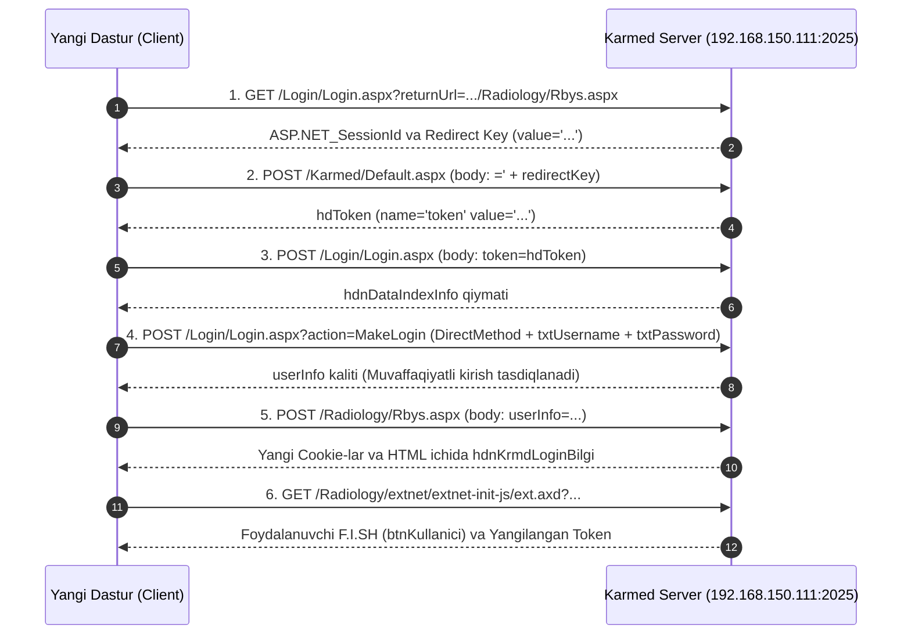

# 🏥 KARMED TIZIMI (LBYS / RBYS / HBYS) INTEGRATSIYA VA AVTORIZATSIYA QO'LLANMASI
> **Fayl nomi:** `karmed_read.me`  
> **Loyiha:** Respublika Onkologiya va Radiologiya Ilmiy-Amaliy Tibbiyot Markazi  
> **Maqsad:** Karmed tibbiy axborot tizimi bilan ulanish, avtomatik kirish (autentifikatsiya), sessiya tokenlarini boshqarish, bemorlar, tekshiruvlar, laboratoriya tahlillari va operatsiyalarni dasturiy (API / RPC) orqali amalga oshirish bo'yicha mukammal qo'llanma.  
> **Oxirgi yangilanish:** 2026-yil Oktyabr

---

## MUNDARIJA

1. [Arxitektura va Tarmoq Topologiyasi](#1-arxitektura-va-tarmoq-topologiyasi)
2. [Karmed Xavfsizlik va Protokol Asoslari](#2-karmed-xavfsizlik-va-protokol-asoslari)
3. [6 Bosqichli Jonli Kirish (Headless Authentication Flow)](#3-6-bosqichli-jonli-kirish-headless-authentication-flow)
4. [Sessiya Tokenlari va Ularning Davriyligi (Token Harvesting & Refresh)](#4-sessiya-tokenlari-va-ularning-davriyligi-token-harvesting--refresh)
5. [Ext.NET DirectMethod / DirectEvent RPC Mexanizmi](#5-extnet-directmethod--directevent-rpc-mexanizmi)
6. [Ext.NET Pseudo-JSON Parsing Qoidalari (`safeParseExtNetJson`)](#6-extnet-pseudo-json-parsing-qoidalari-safeparseextnetjson)
7. [Asosiy API Metodlari va So'rovlar Spetsifikatsiyasi](#7-asosiy-api-metodlari-va-sorovlar-spetsifikatsiyasi)
   - [7.1. Bemorlar va Navbatni Olish (`HastaSorgula`)](#71-bemorlar-va-navbatni-olish-hastasorgula)
   - [7.2. Tekshiruv Organlari va Tashxisni Olish (`TaniHizmetBilgisiGetir`)](#72-tekshiruv-organlari-va-tashxisni-olish-tanihizmetbilgisigetir)
   - [7.3. Bemor Telefon Raqami va Karta Ma'lumotlari (`FillHastaBilgileri`)](#73-bemor-telefon-raqami-va-karta-malumotlari-fillhastabilgileri)
   - [7.4. Laboratoriya Tahlillari: Kreatinin va Mochevina (`LabSonucUrlGetir` ➔ `DosyaListele` ➔ `DetayGoster`)](#74-laboratoriya-tahlillari-kreatinin-va-mochevina)
   - [7.5. Xona va Shifokorni O'zgartirish (`AltBolumuDegistir`)](#75-xona-va-shifokorni-ozgartirish-altbolumudegistir)
   - [7.6. Bemor Qabulini Bekor Qilish (`DosyaIptal`)](#76-bemor-qabulini-bekor-qilish-dosyaiptal)
8. [Bo'limlar va Modalliklar Kodlari Jadvali](#8-bolimlar-va-modalliklar-kodlari-jadvali)
9. [Boshqa Loyihalarda Ishlatish Uchun Tayyor Kodlar](#9-boshqa-loyihalarda-ishlatish-uchun-tayyor-kodlar)
   - [9.1. To'liq Node.js Klient (`KarmedClient.js`)](#91-toliq-nodejs-klient-karmedclientjs)
   - [9.2. To'liq Python Klient (`karmed_client.py`)](#92-toliq-python-klient-karmed_clientpy)
10. [Keng Tarqalgan Muammolar va Ularning Aniq Yechimlari (Troubleshooting)](#10-keng-tarqalgan-muammolar-va-ularning-aniq-yechimlari-troubleshooting)

---

## 1. Arxitektura va Tarmoq Topologiyasi

Karmed — bu shifoxonalarda ishlatiladigan yirik tibbiy axborot tizimi (HIS / RIS / LIS). U Microsoft IIS serverida **ASP.NET WebForms (.NET Framework 4.x)** va **Ext.NET v2/v3** kutubxonasi asosida ishlaydi.

### Tarmoq Manzillari:
| Tarmoq Turi | Host / IP | Port | Protokol | Xususiyati |
| :--- | :--- | :--- | :--- | :--- |
| **Lokal Tarmoq (LAN)** | `192.168.150.111` | `2025` | HTTP | Shifoxona ichki kabel/Wi-Fi tarmog'i. Yuqori tezlik (<20ms). Asosiy kanal! |
| **Tashqi Tarmoq (WAN)** | `213.230.91.59` | `2025` | HTTP | Masofadan internet orqali ulanish. LAN ishlamaganda zaxira (failover) sifatida ishlatiladi. |

> **Qoida:** Har doim avval ichki `192.168.150.111:2025` manziliga murojaat qilinadi. Agar so'rov 3 soniya ichida ulanmasa (`ETIMEDOUT` yoki `EHOSTUNREACH`), avtomatik `213.230.91.59:2025` manziliga ulaniladi.

---

## 2. Karmed Xavfsizlik va Protokol Asoslari

Karmed tizimi klassik REST API emas. U ASP.NET WebForms DirectMethod / AJAX RPC arxitekturasida ishlaydi:

1. **`ASP.NET_SessionId` Cookie:**  
   Boshlang'ich HTTP so'rovda IIS tomonidan generatsiya qilinadi. Barcha keyingi so'rovlarda `Cookie: ASP.NET_SessionId=...` shaklida uzatilishi shart.
2. **`hdnKrmdLoginBilgi` (Asosiy Avtorizatsiya Tokeni):**  
   Bu Karmedning maxfiy, shifrlangan foydalanuvchi chiptasi (Ticket). U ~200-300 belgidan iborat base64 / URL-encoded satr bo'lib, har bir so'rovda POST parametr sifatida uzatiladi.
3. **`__VIEWSTATEGENERATOR`:**  
   Har bir sahifaning statik generatsiya kodi (masalan, `Login.aspx` uchun `5E7FB4E4`, `Rbys.aspx` uchun `5DE5E74B`).
4. **Foydalanuvchi Toifalari:**  
   - `R5`, `R18`, `R1` — Registratorlar (bemorlarni qidirish, ro'yxatga olish, yo'naltirish huquqi mavjud).
   - `U0`, `U1`, ... `U11` — UTT shifokorlari xonalari profillari.
   - `keys.json` orqali login va parol boshqariladi (masalan: `{"username": "R5", "password": "..."}`).

---

## 3. 6 Bosqichli Jonli Kirish (Headless Authentication Flow)

Karmed tizimiga tashqi dasturdan kirish quyidagi ketma-ketlikda amalga oshiriladi:



### Bosqichma-bosqich texnik parametrlar:

#### 1-bosqich: Boshlang'ich SessionId olish
- **Method:** `GET`
- **Path:** `/Login/Login.aspx?returnUrl=http://192.168.150.111:2025/Radiology/Rbys.aspx`
- **Olinadi:** 
  - `Set-Cookie` dan `ASP.NET_SessionId`
  - HTML tana qismidan: `r1.body.match(/value='([^']+)'/)` ➔ `redirectKey`

#### 2-bosqich: Xavfsizlik `token` ini olish
- **Method:** `POST`
- **Path:** `/Karmed/Default.aspx`
- **Headers:** `Content-Type: application/x-www-form-urlencoded`, `Cookie: ASP.NET_SessionId=...`
- **Body:** `=' + redirectKey`
- **Olinadi:** `r2.body.match(/name='token'\s+value='([^']+)'/)` ➔ `tokenVal`

#### 3-bosqich: `hdnDataIndexInfo` ni olish
- **Method:** `POST`
- **Path:** `/Login/Login.aspx?returnUrl=http://192.168.150.111:2025/Radiology/Rbys.aspx`
- **Headers:** `Content-Type: application/x-www-form-urlencoded`, `Cookie: ASP.NET_SessionId=...`
- **Body:** `token=` + encodeURIComponent(tokenVal)
- **Olinadi:** `r3.body.match(/id="hdnDataIndexInfo"[^>]*value="([^"]+)"/)` ➔ `dataIndexInfo`

#### 4-bosqich: `MakeLogin` DirectMethod (Asosiy Parol Tekshiruvi)
- **Method:** `POST`
- **Path:** `/Login/Login.aspx?returnUrl=http%3a%2f%2f192.168.150.111%3a2025%2fRadiology%2fRbys.aspx&action=MakeLogin`
- **Majburiy Headers:**
  ```http
  Content-Type: application/x-www-form-urlencoded; charset=UTF-8
  X-Ext-Net: delta=true
  action: MakeLogin
  X-Requested-With: XMLHttpRequest
  Cookie: ASP.NET_SessionId=...
  ```
- **Form Parametrlari (URLSearchParams):**
  - `submitDirectEventConfig`: `{"config":{"extraParams":{"dataIndex":null}}}`
  - `HdnBaseYazdirmaTuru`: `-1`
  - `__VIEWSTATEGENERATOR`: `5E7FB4E4`
  - `hdnSmsInfo`: `""`
  - `hdnDataIndexInfo`: `dataIndexInfo` (decode qilingan holda)
  - `hdToken`: `tokenVal`
  - `hdReferer`: `192.168.150.111`
  - `hdCaptchaVisible`: `False`
  - `CmbCulture`: `uz-UZ`
  - `txtUsername`: `R5` (yoki foydalanuvchi logini)
  - `txtPassword`: `17720` (foydalanuvchi maxfiy paroli)
  - `HdnAlanMesaj`: `Iltimos, barcha maydonlarni to'ldiring.`
  - `__EVENTTARGET`: `ResLogin`
  - `__EVENTARGUMENT`: `-|public|MakeLogin`
- **Tekshiruv:** Agar javobda `userInfo` so'zi bo'lmasa, demak parol xato!
- **Olinadi:** `r4.body.match(/name='userInfo'\s+value='([^']+)'/)` ➔ `userInfoVal`

#### 5-bosqich: Ishchi Sessiyani Faollashtirish
- **Method:** `POST`
- **Path:** `/Radiology/Rbys.aspx`
- **Body:** `userInfo=` + encodeURIComponent(userInfoVal)
- **Olinadi:** 
  - Yangi `Set-Cookie` lar (ular mavjud cookie ga qo'shiladi).
  - HTML ichidagi `hdnKrmdLoginBilgi` tokeni:
    `r5.body.match(/App\.hdnKrmdLoginBilgi\.setValue\("([^"]+)"\)/)`

#### 6-bosqich: F.I.SH va To'liq Tokenni Mustahkamlash
- **Method:** `GET`
- **Path:** `r5.body` ichidagi `/Radiology/extnet/extnet-init-js/ext.axd?...` script manzili
- **Olinadi:**
  - Foydalanuvchi F.I.SH: `body.match(/\{id:"btnKullanici"[^}]*text:"([^"]+)"/)`
  - Eng so'nggi `hdnKrmdLoginBilgi`: `body.match(/id:"hdnKrmdLoginBilgi"[^}]*value:"([^"]+)"/)`

---

## 4. Sessiya Tokenlari va Ularning Davriyligi (Token Harvesting & Refresh)

> [!IMPORTANT]
> **Token Harvesting Qoidasi:**  
> Karmed har safar qandaydir DirectMethod so'roviga javob berganda, javob matnida yangi avtorizatsiya tokenini qaytarishi mumkin:  
> `App.hdnKrmdLoginBilgi.setValue("YANGI_TOKEN_QIYMATI");`  
> Har bir so'rovdan keyin ushbu token ushlab olinishi va keyingi so'rovlar uchun saqlanishi shart!

### Tokenni ajratuvchi Universal Regex:
```javascript
function extractKarmedLoginBilgi(str) {
  if (!str || typeof str !== 'string') return null;
  const m = str.match(/App\.hdnKrmdLoginBilgi\.setValue\([\\\"\']*([A-Za-z0-9%_+\-\/=]{40,})[\\\"\']*\)/);
  if (m && m[1]) return m[1];
  if (str.includes('hdnKrmdLoginBilgi=')) {
    const m2 = str.match(/hdnKrmdLoginBilgi=([^&\"\'\s]+)/);
    if (m2 && m2[1]) return decodeURIComponent(m2[1]);
  }
  return null;
}
```

### Sessiyaning Eskirishi va Avtomatik Tiklash:
Agar so'rov javobida quyidagilar qaytsa:
1. HTTP 302 Redirect `/Login/Login.aspx` sahifasiga
2. Javob matnida `App.grdHastalarStore` yoki kutilgan JSON bo'lmasa
3. Javob uzunligi juda qisqa bo'lsa (<500 bayt)

U holda sessiya eskirgan hisoblanadi. Klient avtomatik ravishda qayta `loginToKarmedLive()` funksiyasini chaqiradi va so'rovni yangi token bilan takrorlaydi.

---

## 5. Ext.NET DirectMethod / DirectEvent RPC Mexanizmi

Karmed Ext.NET 2.x kutubxonasidan foydalanadi. Serverga so'rov yuborishda quyidagi sarlavhalar va maydonlar doimo bo'lishi shart:

### Standart HTTP Headers:
```http
POST /Radiology/Rbys.aspx?action={MethodName} HTTP/1.1
Host: 192.168.150.111:2025
Connection: keep-alive
Content-Type: application/x-www-form-urlencoded; charset=UTF-8
X-Requested-With: XMLHttpRequest
X-Ext-Net: delta=true
action: {MethodName}
Cookie: ASP.NET_SessionId=...
```

### Standart Form Parametrlari:
| Maydon | Tavsif | Misol |
| :--- | :--- | :--- |
| `__EVENTTARGET` | Resurs boshqaruvchisi | `ctl00$ResourceManagerX` yoki `ResourceManager1` |
| `__EVENTARGUMENT` | Metod yo'li | `-\|public\|{MethodName}` |
| `hdnKrmdLoginBilgi` | Faol sessiya tokeni | Amaldagi `loginBilgi` |
| `submitDirectEventConfig` | Metodga beriladigan JSON argumentlar | `{"config":{"extraParams":{...}}}` |
| `__VIEWSTATEGENERATOR` | Sahifa generatsiya kodi | `5DE5E74B` |

---

## 6. Ext.NET Pseudo-JSON Parsing Qoidalari (`safeParseExtNetJson`)

Karmed qaytaradigan Ext.NET javoblari standart JSON emas! Ularda sana qiymatlari C# formatida quyidagicha uzatiladi:
```javascript
"KayitTarihi": new Date(1725868800000), "KabulTarihi": new Date(1725872400000)
```
Agar `JSON.parse()` to'g'ridan-to'g'ri chaqirilsa, `Unexpected token 'n', ... is not valid JSON` xatosi chiqadi!

### Universal Xavfsiz Parser Funksiyasi:
```javascript
function safeParseExtNetJson(str) {
  if (!str) return null;
  try {
    return JSON.parse(str);
  } catch (e) {
    try {
      return JSON.parse(str.replace(/\\"/g, '"'));
    } catch (e2) {
      try {
        // new Date(...) larni standart ISO sana satriga almashtiramiz
        const clean = str
          .replace(/new Date\(([-+]?\d+)\)/g, (match, p1) => {
            const d = new Date(parseInt(p1, 10));
            return `"${d.toISOString()}"`;
          })
          .replace(/new Date\([^)]+\)/g, '"2026-01-01T00:00:00.000Z"')
          .replace(/\\"/g, '"');
        return JSON.parse(clean);
      } catch (e3) {
        return null;
      }
    }
  }
}
```

---

## 7. Asosiy API Metodlari va So'rovlar Spetsifikatsiyasi

### 7.1. Bemorlar va Navbatni Olish (`HastaSorgula`)
Ushbu metod tanlangan sana oralig'idagi yoki bo'limdagi barcha bemorlar ro'yxatini qaytaradi.

- **URL:** `POST /Radiology/Rbys.aspx?action=HastaSorgula`
- **Event Target:** `ctl00$ResourceManagerX`
- **Event Argument:** `-|public|HastaSorgula`
- **Parametrlar:**
  ```javascript
  const params = new URLSearchParams();
  params.set('submitDirectEventConfig', JSON.stringify({
    config: { extraParams: { aDosyaDurumu: null, aHizliAra: false } }
  }));
  params.set('cbYil', '2026');
  params.set('_cbYil_state', JSON.stringify([{ value: '2026', text: '2026', index: 1 }]));
  params.set('cbHizliAramaTur', 'Bemor ID');
  params.set('_cbHizliAramaTur_state', JSON.stringify([{ value: '0', text: 'Bemor ID', index: 0 }]));
  params.set('tfHizliAramaDeger', ''); // Qidiruv uchun bemor ID yoki barkod raqami
  params.set('BaslangicDt', '12.10.2026'); // DD.MM.YYYY
  params.set('BitisDt', '17.10.2026');     // DD.MM.YYYY
  params.set('cbBolum', 'Ultratovush, Dopler Ultratovush'); // Yoki bo'sh (barcha bo'limlar)
  params.set('cbAltBolum', '(Subbirliklar)');
  params.set('cbBolumOda', '(Barcha Xonalar)');
  params.set('cbBirimTuru', '(Butun Birlik)');
  params.set('cbBina', '(Butun Binolar)');
  params.set('cbKayitSayisiSecim', '1000'); // Maksimal yozuvlar soni: 50, 100, 500, 1000
  params.set('btnTumu_Pressed', 'true');
  params.set('btnBekleyen_Pressed', '');
  params.set('HdnBaseYazdirmaTuru', '-1');
  params.set('__VIEWSTATEGENERATOR', '5DE5E74B');
  params.set('hdnKrmdLoginBilgi', token);
  params.set('__EVENTTARGET', 'ctl00$ResourceManagerX');
  params.set('__EVENTARGUMENT', '-|public|HastaSorgula');
  ```
- **Javobdan ma'lumotni ajratish:**
  ```javascript
  const match = res.body.match(/App\.grdHastalarStore\.proxy\.data\s*=\s*(\[.*?\]);/s);
  const patientsList = safeParseExtNetJson(match[1]);
  ```

#### Bemor Obyektining Asosiy Maydonlari:
| Maydon Nomi | Turi | Tavsif | Misol |
| :--- | :--- | :--- | :--- |
| `Id` / `LabDosyaId` | `Number` | Karmed laboratoriya / tekshiruv fayli ID | `2498690` |
| `KimlikNo` | `Number` | Bemorning shaxsiy kartoteka ID raqami | `52360` |
| `ProtokolNo` | `Number` | Bemorning kasallik tarixi / protokol raqami | `10036` |
| `AdSoyad` / `HastaAdi` | `String` | Bemorning Familiyasi, Ismi, Sharifi | `ALIMOV VALI KARIMOVICH` |
| `DosyaDurumu` | `Number` | Holat kodi (`8` = Tekshiruvdan o'tdi, `4` = Qabul qilindi, `0` = Kutmoqda) | `8` |
| `Durum` | `String` | Holat matni | `Rapor Onaylı`, `Kabul Edilen`, `Bekleyen` |
| `KayitTarihi` | `String` | Ro'yxatga olingan sana va vaqt | `2026-10-14T09:15:00` |
| `AltBolumAdi` | `String` | Yo'naltirilgan xona / apparat nomi | `Ultratovush-9 (50-xona)` |
| `DoktorAdi` | `String` | Xonaga biriktirilgan yoki qabul qiluvchi shifokor | `Xusanova Feruza Ikromjonovna` |
| `DosyaDoktoru` | `String` | Yo'llanma bergan davolovchi shifokor | `Dr. Inoyatov Shavkat` |
| `ServisAdi` | `String` | Yuborgan bo'lim nomi | `Poliklinika`, `Kimyoterapiya` |
| `KurumAdi` | `String` | Moliyalashtirish manbai | `Sug'urta`, `Orderli`, `Vaqf`, `Pullik` |

---

### 7.2. Tekshiruv Organlari va Tashxisni Olish (`TaniHizmetBilgisiGetir`)
Bemorga biriktirilgan barcha tekshiruv sohalari (masalan, Qorin bo'shlig'i, Qalqonsimon bez, Buyraklar) va shifokor qo'ygan tashxisni oladi.

- **URL:** `POST /Radiology/Rbys.aspx?action=TaniHizmetBilgisiGetir`
- **Event Target:** `ctl00$ResourceManagerX`
- **Event Argument:** `-|public|TaniHizmetBilgisiGetir`
- **`submitDirectEventConfig` Parametrlari:**
  ```json
  {
    "config": {
      "extraParams": {
        "aLabDosyaId": 2498690,
        "aOnkayitSiraNo": 12044,
        "aYatPol": "P",
        "aProtokolNo": 10036,
        "aKimlikId": 52360,
        "aHastaAdi": "ALIMOV VALI",
        "aBolumId": 10,
        "mrrsProtokolNo": null
      }
    }
  }
  ```
- **Javobdan ma'lumotni ajratish:**
  - **Tashxis:**
    ```javascript
    const mDiag = res.body.match(/lblTanilar\.setText\((.*?)\);/);
    const diagnosis = mDiag ? mDiag[1].split(',')[0].replace(/^"|"$/g, '').replace(/\\"/g, '"').trim() : '';
    ```
  - **Tekshiruv Organlari (Hizmetler):**
    ```javascript
    const mServ = res.body.match(/App\.grdHizmetlerStore\.loadData\((\[.*?\])\);/s);
    const servicesList = safeParseExtNetJson(mServ[1]);
    // Har bir elementda: TetkikKodu, KodAra (masalan, 'R62'), TetkikIsmi, DoktorAdSoyad
    ```

---

### 7.3. Bemor Telefon Raqami va Karta Ma'lumotlari (`FillHastaBilgileri`)
Bemorning shaxsiy kartasidan telefon raqami (Gsm, Uy telefoni, Qarindoshi telefoni) va yashash manzilini tortib oladi.

- **URL:** `POST /Karmed/HastaKayit/Default.aspx?action=FillHastaBilgileri`
- **Event Target:** `HbysResource`
- **Event Argument:** `-|public|FillHastaBilgileri`
- **`submitDirectEventConfig` Parametrlari:**
  ```json
  {
    "config": {
      "extraParams": {
        "kimlikNo": 52360,
        "listeYenile": false
      }
    }
  }
  ```
- **Javobdan telefon raqamini ajratish:**
  ```javascript
  // 1-usul: TxtGsmKimlik setValue
  const mPhone1 = res.body.match(/TxtGsmKimlik\.setValue\(\\"([^\\"]*)\\"\)/);

  // 2-usul: frmAdresBilgi form JSON
  const mAdres = res.body.match(/frmAdresBilgi\.getForm\(\)\.setValues\((\{.+?\})\);/);
  if (mAdres) {
    const adresObj = JSON.parse(mAdres[1].replace(/\\"/g, '"'));
    const phone = adresObj.Gsm || adresObj.Tel || adresObj.TelYakini;
  }
  ```

---

### 7.4. Laboratoriya Tahlillari: Kreatinin va Mochevina
Kontrast moddasi yuborishdan oldin bemorning buyrak faoliyatini tekshirish uchun Karmed LIS tizimidan tahlillarni 3 bosqichli zanjir orqali olish tartibi:

```
[1. LabSonucUrlGetir] ➔ LBYSOnkayitSonucGosterPage.aspx URL manzili olinadi
         ↓
[2. DosyaListele]     ➔ Bemorning barcha laboratoriya tahlil fayllari ro'yxati (StoreLabDosya)
         ↓
[3. DetayGoster]      ➔ Tanlangan tahlil ichidagi ko'rsatkichlar (StoreLda: Kreatinin, Mochevina qiymati, normasi)
```

1. **`LabSonucUrlGetir`:**
   - URL: `POST /Radiology/Rbys.aspx?action=LabSonucUrlGetir`
   - ExtraParams: `{"aOnKayitId": onKayitId, "aKimlikId": kimlikId}`
   - Olinadi: `/Lis/UI/OrtakFrames/LBYSOnkayitSonucGosterPage.aspx?DosyaId=...`
2. **`DosyaListele`:**
   - URL: `POST {LabPageUrl}&action=DosyaListele`
   - Javobdan: `App.StoreLabDosya.proxy.data = [...]` ➔ Laboratoriya fayllari (DosyaId).
3. **`DetayGoster`:**
   - URL: `POST {LabPageUrl}&action=DetayGoster`
   - ExtraParams: `{"aLdSiraNo": dosyaId, "aUyusturucuGorunsun": false}`
   - Javobdan: `App.StoreLda.proxy.data = [...]` ➔ Ko'rsatkichlar:
     - `TetkikAdi`: 'Qonda Kreatinin Miqdori'
     - `Sonuc` / `SonucNumber`: '78.5'
     - `RefMin` - `RefMax`: '44 - 115 μmol/L'
     - `Uyari`: 'Normal' yoki 'Yuksek'
     - `OnayTarihi`: Tahlil tasdiqlangan sana

---

### 7.5. Xona va Shifokorni O'zgartirish (`AltBolumuDegistir`)
Bemor navbatini boshqa UTT xonasiga yoki boshqa shifokorga qayta yo'naltirish (reassign) amali.

- **URL:** `POST /Radiology/Rbys.aspx?action=AltBolumuDegistir`
- **Event Target:** `ctl00$ResourceManagerX`
- **Event Argument:** `-|public|AltBolumuDegistir`
- **`submitDirectEventConfig` Parametrlari:**
  ```json
  {
    "config": {
      "extraParams": {
        "aLabDoysaId": 2498690,
        "aYeniAltBolumId": 48,
        "aYeniOdaId": null
      }
    }
  }
  ```
- **Natija:** Karmed ma'lumotlar bazasida bemor yangi xonaga biriktiriladi.

---

### 7.6. Bemor Qabulini Bekor Qilish (`DosyaIptal`)
Xatolik bilan ochilgan navbatni yoki qabul qilingan bemor holatini bekor qilish (navbatga qaytarish yoki yo'llanmani yopish).

- **URL:** `POST /Radiology/Rbys.aspx?action=DosyaIptal`
- **Event Target:** `ctl00$ResourceManagerX`
- **Event Argument:** `RbysDosya|public|DosyaIptal`
- **`submitDirectEventConfig` Parametrlari:**
  ```json
  {
    "config": {
      "extraParams": {
        "aDosyaId": 2498690
      }
    }
  }
  ```

---

## 8. Bo'limlar va Modalliklar Kodlari Jadvali

`HastaSorgula` so'rovida `cbBolum` parametri uchun quyidagi rasmiy qiymatlar ishlatiladi:

| Bo'lim Nomi | `cbBolum` matni | `value` kodi | `index` |
| :--- | :--- | :--- | :--- |
| **Barcha Bo'limlar** | `""` (bo'sh satr) | `""` | `-` |
| **MRT (Magnit-Rezonans)** | `MRT` | `1` | `5` |
| **MSKT (Kompyuter Tomografiya)** | `Tomografiya(MSCT)` | `2` | `8` |
| **Ultratovush (UTT)** | `Ultratovush` | `10` | `9` |
| **Dopler Ultratovush** | `Dopler Ultratovush` | `24` | `0` |
| **Mammografiya** | `Mammografiya` | `4` | `4` |
| **Rentgen** | `Rentgen` | `3` | `3` |

---

## 9. Boshqa Loyihalarda Ishlatish Uchun Tayyor Kodlar

### 9.1. To'liq Node.js Klient (`KarmedClient.js`)

Quyidagi kodni istalgan Node.js loyihangizga fayl qilib saqlang va to'g'ridan-to'g'ri chaqiring:

```javascript
/**
 * KarmedClient.js - Karmed LBYS/RBYS bilan ishlash uchun to'liq universal klient
 */
const http = require('http');

class KarmedClient {
  constructor(options = {}) {
    this.hosts = [options.host || '192.168.150.111', '213.230.91.59'];
    this.port = options.port || 2025;
    this.username = options.username || 'R5';
    this.password = options.password || '17720';
    this.token = null;
    this.cookie = '';
    this.activeHost = this.hosts[0];
  }

  // HTTP Xom So'rov
  _rawRequest(host, path, method, headers, postData = null, timeoutMs = 45000) {
    return new Promise((resolve, reject) => {
      const req = http.request({
        hostname: host,
        port: this.port,
        path: path,
        method: method,
        headers: headers
      }, res => {
        let data = '';
        res.on('data', chunk => data += chunk);
        res.on('end', () => {
          // Tokenni tutib olish (Harvesting)
          const m = data.match(/App\.hdnKrmdLoginBilgi\.setValue\([\\\"\']*([A-Za-z0-9%_+\-\/=]{40,})[\\\"\']*\)/);
          if (m && m[1]) this.token = m[1];

          // Cookie larni saqlash
          if (res.headers['set-cookie']) {
            const newCookies = res.headers['set-cookie'].map(c => c.split(';')[0]).join('; ');
            this.cookie = this.cookie ? (this.cookie + '; ' + newCookies) : newCookies;
          }

          resolve({ statusCode: res.statusCode, headers: res.headers, body: data });
        });
      });
      req.on('error', reject);
      req.setTimeout(timeoutMs, () => {
        req.destroy(new Error(`Timeout (${timeoutMs}ms) on ${host}`));
      });
      if (postData) req.write(postData);
      req.end();
    });
  }

  // Xavfsiz Ext.NET JSON Parser
  safeParse(str) {
    if (!str) return null;
    try {
      const clean = str
        .replace(/new Date\(([-+]?\d+)\)/g, (m, p) => `"${new Date(parseInt(p, 10)).toISOString()}"`)
        .replace(/new Date\([^)]+\)/g, '"2026-01-01T00:00:00.000Z"')
        .replace(/\\"/g, '"');
      return JSON.parse(clean);
    } catch (e) {
      return null;
    }
  }

  // Karmedga Avtomatik Kirish (6 Bosqich)
  async login() {
    for (const host of this.hosts) {
      try {
        console.log(`[KarmedClient] ${host} orqali tizimga kirilmoqda (${this.username})...`);
        
        // 1. GET Login.aspx
        const r1 = await this._rawRequest(host, '/Login/Login.aspx?returnUrl=http://' + host + ':2025/Radiology/Rbys.aspx', 'GET', {
          'User-Agent': 'Mozilla/5.0'
        });
        const m1 = r1.body.match(/value='([^']+)'/);
        if (!m1) continue;

        // 2. POST /Karmed/Default.aspx
        const r2 = await this._rawRequest(host, '/Karmed/Default.aspx', 'POST', {
          'Content-Type': 'application/x-www-form-urlencoded',
          'Cookie': this.cookie,
          'User-Agent': 'Mozilla/5.0'
        }, '=' + m1[1]);
        const m2 = r2.body.match(/name='token'\s+value='([^']+)'/);
        if (!m2) continue;
        const tokenVal = m2[1];

        // 3. POST Login.aspx (Token bilan)
        const r3 = await this._rawRequest(host, '/Login/Login.aspx?returnUrl=http://' + host + ':2025/Radiology/Rbys.aspx', 'POST', {
          'Content-Type': 'application/x-www-form-urlencoded',
          'Cookie': this.cookie,
          'User-Agent': 'Mozilla/5.0'
        }, 'token=' + encodeURIComponent(tokenVal));
        const mIndex = r3.body.match(/id="hdnDataIndexInfo"[^>]*value="([^"]+)"/);
        const dataIndex = mIndex ? mIndex[1] : '';

        // 4. POST MakeLogin
        const p = new URLSearchParams();
        p.set('submitDirectEventConfig', JSON.stringify({ config: { extraParams: { dataIndex: null } } }));
        p.set('HdnBaseYazdirmaTuru', '-1');
        p.set('__VIEWSTATEGENERATOR', '5E7FB4E4');
        p.set('hdnDataIndexInfo', decodeURIComponent(dataIndex));
        p.set('hdToken', tokenVal);
        p.set('hdReferer', host);
        p.set('hdCaptchaVisible', 'False');
        p.set('CmbCulture', 'uz-UZ');
        p.set('txtUsername', this.username);
        p.set('txtPassword', this.password);
        p.set('__EVENTTARGET', 'ResLogin');
        p.set('__EVENTARGUMENT', '-|public|MakeLogin');

        const pStr = p.toString();
        const r4 = await this._rawRequest(host, '/Login/Login.aspx?action=MakeLogin', 'POST', {
          'Content-Type': 'application/x-www-form-urlencoded',
          'X-Ext-Net': 'delta=true',
          'action': 'MakeLogin',
          'X-Requested-With': 'XMLHttpRequest',
          'Cookie': this.cookie
        }, pStr);

        const mUser = r4.body.match(/name='userInfo'\s+value='([^']+)'/);
        if (!mUser) throw new Error("Login yoki parol noto'g'ri!");

        // 5. POST /Radiology/Rbys.aspx
        const r5 = await this._rawRequest(host, '/Radiology/Rbys.aspx', 'POST', {
          'Content-Type': 'application/x-www-form-urlencoded',
          'Cookie': this.cookie
        }, 'userInfo=' + encodeURIComponent(mUser[1]));

        // 6. extnet-init-js
        const mScript = r5.body.match(/src="(\/Radiology\/extnet\/extnet-init-js\/ext\.axd\?[^"]+)"/);
        if (mScript) {
          const r6 = await this._rawRequest(host, mScript[1], 'GET', { 'Cookie': this.cookie });
          const mTok = r6.body.match(/id:"hdnKrmdLoginBilgi"[^}]*value:"([^"]+)"/);
          if (mTok && mTok[1]) this.token = mTok[1];
        }

        this.activeHost = host;
        console.log(`[KarmedClient] Muvaffaqiyatli ulandi! Host: ${this.activeHost}`);
        return true;
      } catch (err) {
        console.warn(`[KarmedClient] ${host} orqali ulanishda xato:`, err.message);
      }
    }
    throw new Error("Karmed serverlariga ulanib bo'lmadi!");
  }

  // Bemorlarni Qidirish (HastaSorgula)
  async queryPatients(startDate, endDate, options = {}) {
    if (!this.token) await this.login();

    const params = new URLSearchParams();
    params.set('submitDirectEventConfig', JSON.stringify({ config: { extraParams: { aDosyaDurumu: null, aHizliAra: false } } }));
    params.set('cbYil', '2026');
    params.set('BaslangicDt', startDate); // DD.MM.YYYY
    params.set('BitisDt', endDate || startDate);
    params.set('cbBolum', options.bolum || '');
    params.set('cbKayitSayisiSecim', String(options.limit || 500));
    params.set('btnTumu_Pressed', 'true');
    params.set('hdnKrmdLoginBilgi', this.token);
    params.set('__EVENTTARGET', 'ctl00$ResourceManagerX');
    params.set('__EVENTARGUMENT', '-|public|HastaSorgula');

    const sp = params.toString();
    const res = await this._rawRequest(this.activeHost, '/Radiology/Rbys.aspx?action=HastaSorgula', 'POST', {
      'Content-Type': 'application/x-www-form-urlencoded; charset=UTF-8',
      'X-Ext-Net': 'delta=true',
      'action': 'HastaSorgula',
      'X-Requested-With': 'XMLHttpRequest',
      'Cookie': this.cookie
    }, sp, 60000);

    // Agar sessiya tugagan bo'lsa, qayta kiramiz
    if (res.body.includes('/Login/Login.aspx') || !res.body.includes('grdHastalarStore')) {
      console.log('[KarmedClient] Sessiya eskirgan, yangilanmoqda...');
      await this.login();
      return await this.queryPatients(startDate, endDate, options);
    }

    const m = res.body.match(/App\.grdHastalarStore\.proxy\.data\s*=\s*(\[.*?\]);/s);
    return m ? (this.safeParse(m[1]) || []) : [];
  }
}

module.exports = KarmedClient;
```

---

### 9.2. To'liq Python Klient (`karmed_client.py`)

Python dasturchilari uchun `requests.Session` asosidagi tayyor yechim:

```python
import re
import json
import urllib.parse
import requests

class KarmedClient:
    def __init__(self, host="192.168.150.111", port=2025, username="R5", password="..."):
        self.host = host
        self.port = port
        self.base_url = f"http://{host}:{port}"
        self.username = username
        self.password = password
        self.session = requests.Session()
        self.token = None

    def login(self):
        print(f"Karmedga ulanilmoqda: {self.base_url}")
        # 1. GET Login.aspx
        r1 = self.session.get(f"{self.base_url}/Login/Login.aspx?returnUrl={self.base_url}/Radiology/Rbys.aspx")
        m1 = re.search(r"value='([^']+)'", r1.text)
        if not m1:
            raise Exception("Boshlang'ich kalit topilmadi")

        # 2. POST Default.aspx
        r2 = self.session.post(f"{self.base_url}/Karmed/Default.aspx", data="=" + m1.group(1))
        m2 = re.search(r"name='token'\s+value='([^']+)'", r2.text)
        token_val = m2.group(1)

        # 3. POST Login.aspx (Token bilan)
        r3 = self.session.post(f"{self.base_url}/Login/Login.aspx?returnUrl={self.base_url}/Radiology/Rbys.aspx", data={"token": token_val})
        m_index = re.search(r'id="hdnDataIndexInfo"[^>]*value="([^"]+)"', r3.text)
        data_index = m_index.group(1) if m_index else ""

        # 4. POST MakeLogin
        data_login = {
            "submitDirectEventConfig": json.dumps({"config": {"extraParams": {"dataIndex": None}}}),
            "HdnBaseYazdirmaTuru": "-1",
            "__VIEWSTATEGENERATOR": "5E7FB4E4",
            "hdnDataIndexInfo": urllib.parse.unquote(data_index),
            "hdToken": token_val,
            "hdReferer": self.host,
            "hdCaptchaVisible": "False",
            "CmbCulture": "uz-UZ",
            "txtUsername": self.username,
            "txtPassword": self.password,
            "__EVENTTARGET": "ResLogin",
            "__EVENTARGUMENT": "-|public|MakeLogin"
        }
        headers = {
            "X-Ext-Net": "delta=true",
            "action": "MakeLogin",
            "X-Requested-With": "XMLHttpRequest"
        }
        r4 = self.session.post(f"{self.base_url}/Login/Login.aspx?action=MakeLogin", data=data_login, headers=headers)
        m_user = re.search(r"name='userInfo'\s+value='([^']+)'", r4.text)
        if not m_user:
            raise Exception("Login yoki parol noto'g'ri!")

        # 5. POST Rbys.aspx
        r5 = self.session.post(f"{self.base_url}/Radiology/Rbys.aspx", data={"userInfo": m_user.group(1)})
        
        # 6. ExtNet init
        m_script = re.search(r'src="(/Radiology/extnet/extnet-init-js/ext\.axd\?[^"]+)"', r5.text)
        if m_script:
            r6 = self.session.get(f"{self.base_url}{m_script.group(1)}")
            m_tok = re.search(r'id:"hdnKrmdLoginBilgi"[^}]*value:"([^"]+)"', r6.text)
            if m_tok:
                self.token = m_tok.group(1)

        print("Muvaffaqiyatli ulandi!")
        return True

    def query_patients(self, start_date, end_date):
        if not self.token:
            self.login()
        data = {
            "submitDirectEventConfig": json.dumps({"config": {"extraParams": {"aDosyaDurumu": None, "aHizliAra": False}}}),
            "cbYil": "2026",
            "BaslangicDt": start_date,
            "BitisDt": end_date,
            "cbBolum": "",
            "cbKayitSayisiSecim": "500",
            "btnTumu_Pressed": "true",
            "hdnKrmdLoginBilgi": self.token,
            "__EVENTTARGET": "ctl00$ResourceManagerX",
            "__EVENTARGUMENT": "-|public|HastaSorgula"
        }
        headers = {
            "X-Ext-Net": "delta=true",
            "action": "HastaSorgula",
            "X-Requested-With": "XMLHttpRequest"
        }
        r = self.session.post(f"{self.base_url}/Radiology/Rbys.aspx?action=HastaSorgula", data=data, headers=headers)
        m = re.search(r"App\.grdHastalarStore\.proxy\.data\s*=\s*(\[.*?\]);", r.text, re.DOTALL)
        if m:
            clean = re.sub(r"new Date\([^)]+\)", '"2026-01-01"', m.group(1))
            return json.loads(clean)
        return []
```

---

## 10. Keng Tarqalgan Muammolar va Ularning Aniq Yechimlari (Troubleshooting)

### 1. `TimeoutError / ETIMEDOUT (12s / 30s)`
- **Sababi:** Karmed katta hajmdagi sanalarni (masalan, butun oylik bemorlarni) hisoblayotganda SQL so'rov vaqti 30-50 soniyagacha cho'zilishi mumkin.
- **Yechim:** So'rov timeout qiymatini minimal `60000` (60 soniya) yoki `120000` (2 daqiqa) qilib belgilang. Shuningdek, sanani kichikroq bo'laklarga (masalan, 1 haftalik intervallarga) bo'lib so'rang.

### 2. `Unexpected token 'n' in JSON at position ...`
- **Sababi:** Ext.NET javobida `new Date(...)` konstruktsiyasi mavjud.
- **Yechim:** Matnni `JSON.parse` ga berishdan oldin `str.replace(/new Date\([^)]+\)/g, '"..."')` bilan tozalang (6-bo'limga qarang).

### 3. `hdnKrmdLoginBilgi tokeni yaroqsiz / Login sahifasiga qaytish`
- **Sababi:** Foydalanuvchi Karmedga boshqa kompyuterdan kirgan yoki sessiya muddati (30 daqiqa harakatsizlikdan so'ng) tugagan.
- **Yechim:** So'rov natijasida `/Login/Login.aspx` ko'rinsa, zudlik bilan `login()` funksiyasini qayta ishga tushirib, yangi token bilan so'rovni takrorlang.

### 4. `Lokal tarmoq uzilishi (LAN Down)`
- **Sababi:** Shifoxona ichki tarmog'ida kommutator yoki kabel uzilgan.
- **Yechim:** Dastur ichida avtomatik zaxira manziliga (`213.230.91.59:2025`) ulanish zanjirini saqlang.

### 5. `Bemorning tahlillari topilmadi`
- **Sababi:** Tahlil topshirilganiga 30 kundan oshgan yoki u LIS tizimida hali tasdiqlanmagan (`Onaylanmamis`).
- **Yechim:** Tahlil holati `OnayTarihi` mavjudligini va `Sonuc` maydoni to'ldirilganligini tekshiring.

---

*Hujjat Respublika Onkologiya Markazi UTT va Radiologiya integratsiya guruhi tomonidan sinovdan o'tkazilgan va tasdiqlangan.*
